# The build

The build turns cases into synthetic genomes. It works in two phases with very different costs. A background, a real
trio such as a 1000 Genomes family, is prepared once: called with DRAGEN across the whole genome, phased, and topped up
with novel variants. Every case built into it is then cheap, because a case only edits reads at its placed sites and
calls DRAGEN again around them, carrying everything else over from the background. A synthetic genome has to look like a
fully called WGS trio from a laboratory, so the background carries every DRAGEN caller's output, even where the first
release only places small variants.

This document maps that design onto the pipeline in [`build/`](../build), step by step, and records why each step is
done the way it is.

## Overview

```mermaid
flowchart LR
  subgraph once["Per background: once, pinned"]
    B1["B1 · DRAGEN, whole genome<br/>every caller, joint calls in pedigree mode<br/><b>built</b>"]
    B2["B2 · trio phasing, read tags<br/><b>to do</b>"]
    B3["B3 · added variants<br/>through case builds, then rephasing<br/><b>to do</b>"]
    B4[("B4 · catalogue entry<br/>files, tags, DRAGEN settings<br/><b>partly built</b>")]
    B1 --> B2 --> B3 --> B4
  end
  subgraph many["Per case: many, cheap"]
    C1["C1 · placements onto tagged reads<br/>edit in place<br/><b>to do</b>"]
    C2["C2 · DRAGEN over windows<br/>small variants, the case's PED file<br/><b>shape built: slice mode</b>"]
    C3["C3 · merge into copies of the background's files<br/>genome-wide calls carried over<br/><b>to do</b>"]
    C4["C4 · checks, manifest, build record<br/><b>to do</b>"]
    C1 --> C2 --> C3 --> C4
  end
  B4 --> C1
  C4 --> SG[("synthetic genome")]
```

## Preparing a background

### B1: calling

`build/main.nf` without `--regions`. `PREPARE_CRAM` names each member's sample after the sample sheet, then
`DRAGEN_GERMLINE` maps each member's reads afresh against Illumina's hg38 pangenome reference and runs the callers of
Illumina's germline WGS recipe for DRAGEN 4.6: small variants (as a gVCF), structural variants, copy number, HLA, short
tandem repeats, star alleles and PGx, the targeted callers and MRJD for paralogous genes. The family is then called
jointly in pedigree mode, which adds de novo calls: small variants from the gVCFs (`DRAGEN_PEDIGREE`), copy number from
the members' normalised counts (`DRAGEN_JOINT_CNV`), structural variants from the members' CRAMs (`DRAGEN_JOINT_SV`),
and uniparental disomy in the child of a trio (`DRAGEN_UPD`).

Two parts of the recipe are left out. Annotation needs Illumina's Nirvana database, and a system under test receives
DRAGEN's output with the annotation removed. Allele-specific copy number needs a population SNP VCF that nothing here
provides yet.

With `--regions`, the pipeline prepares a slice instead: it cuts each CRAM down to the regions and calls small variants
only, since the copy number caller normalises against the whole genome's coverage. Slices are for tests (`build/slice/`
holds a 1000 Genomes trio and two 2 Mb regions), and their shape is that of a case's window run (C2).

### B2: phasing

Building a case edits the reads of one chromosome copy of one member, such as the child's paternal copy or the copy a
father transmitted. That needs three things the build cannot get from DRAGEN:

- Phase that holds along a chromosome and is labelled by parent: which of the child's copies is paternal, and for each
  parent which copy was transmitted along each chromosome, with the crossovers between them. DRAGEN's small variant
  caller phases within one sample and within one active region at a time, and its phase sets are valid "within a given
  sample (but not across samples)"
  ([DRAGEN phasing](https://support-docs.illumina.com/SW/dragen_v42/Content/SW/DRAGEN/PhasingPhasedVariants_fDG.htm)).
  Its pedigree mode uses inheritance to classify de novo calls and adjust genotypes, not to phase
  ([pedigree analysis](https://help.connected.illumina.com/dragen/dragen-v4.5/product-guides/dragen-v4.5/dragen-dna-pipeline/small-variant-calling/pedigree-analysis)).
- Reads tagged with their copy. DRAGEN 4.6 writes haplotype tags only for TruPath Genome, which needs TruPath's
  long-range library and is not supported in Software Mode
  ([4.6.2 release notes](https://help.connected.illumina.com/dragen/dragen-v4.6/reference/release-notes-readme/dragen-crn-v4.6.2)).
- The design's rules for chrX: the mother phased from her reads alone, and a daughter's paternal X taken from the
  father.

B1 provides what phasing needs: the members' CRAMs and the joint VCF with its de novo calls. The proposal for B2 is
WhatsHap (MIT licence), which phases from reads and pedigree together (`whatshap phase --ped`), followed by labelling
each child's copies paternal and maternal and recording each parent's transmitted copy by comparing the members' alleles
at informative sites.

Tagging reads (`whatshap haplotag`) assigns each read to the copy whose alleles it matches at the phased sites it
covers. It is an inference from the phased VCF and the reads, so tags are no more exact than the phased VCF itself, and
reads that cover no phased site stay untagged either way. B2 still tags the members' CRAMs once, in full, and keeps them
in the catalogue entry: the design requires every window to agree on every read pair and duplicate pairs to stay
together, which a single pass over each CRAM gives for free, whereas tagging per window would have to fetch each read's
mate and duplicates from outside the window. It costs a few CPU hours and about 55 GB of storage per trio, once.

### B3: added variants

A 1000 Genomes child carries almost no variant that public frequency databases lack, so a placed variant would be its
only novel one. B3 adds variants absent from those databases, drawn from consented cohort participants, as placements
built through the same case build, and then phases the affected windows again.

### B4: the catalogue entry

Everything a case build reuses from the background: the files, the tagged CRAMs and phasing, and DRAGEN's settings,
which every case build has to reuse so that its window runs score reads as the background did. Each DRAGEN run writes
its complete settings to `<prefix>-replay.json`, which the manifest names as `dragen_replay` for each member's run and
for the family's small variant run. Each prepared background is published under its own version folder (see
`build/README.md`, "Outputs").

## Building a case

C1 resolves each placement to the reads of its copy, using the tags, assigns untagged read pairs to a copy with a
reproducible function, and edits the reads in place. C2 runs DRAGEN over a window of reads around each placed site, with
the background's settings and the case's own PED file. C3 merges the window's output into copies of the background's
files so that nothing localises the window, and carries the genome-wide outputs (copy number, structural variants,
repeats) over unchanged. C4 runs the design's three checks and writes the manifest and build record.

The design runs the first builds end to end, calling the whole trio again, and switches to windows once a comparison
shows the two agree. Since that would make each case cost as much as its background, end-to-end builds are kept to the
comparison itself, and every other case uses windows from the start.

## Cost

DRAGEN Software Mode is licensed per sample in BioInsight credits (BIC). Calling a whole genome with every caller is the
Comprehensive tier, 15 BIC per genome, so 45 BIC per trio, paid once per background version; joint genotyping and
pedigree analysis are not charged, though whether the joint structural variant run, which reads the members' CRAMs
again, counts as either is still to be confirmed. A case's window run calls small variants over a target BED, which
Illumina bills as a small panel when it touches at most 200 genes (2 BIC per sample in the Foundation tier); that a
window run is billed this way is still to be confirmed from a real run's usage record. Phasing and tagging run on
ordinary VMs.
