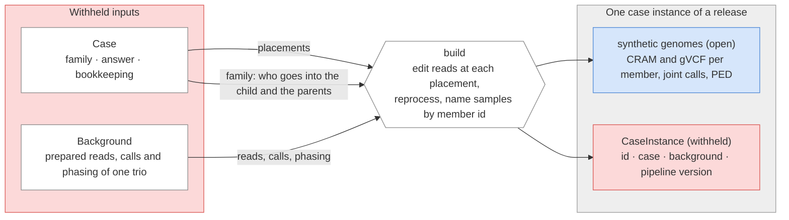
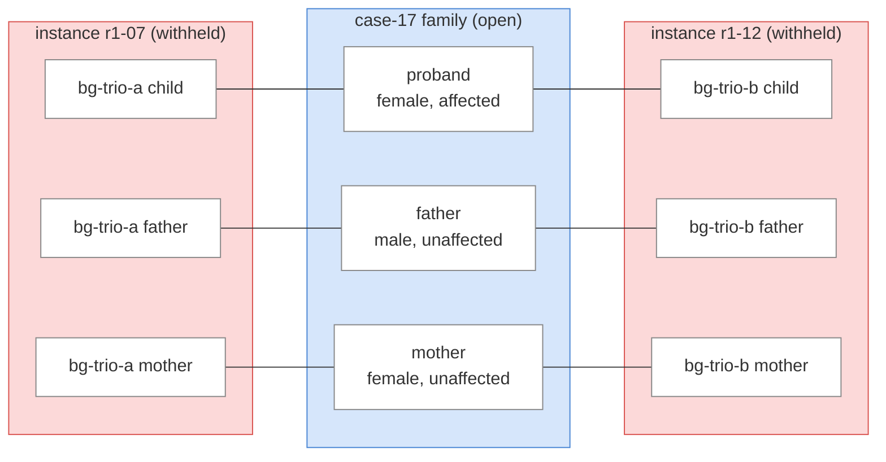
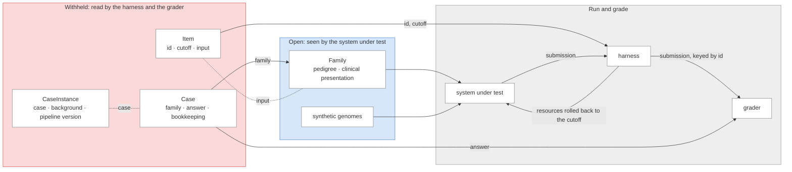

# The schema

The schema describes three things: the record a curator writes for one solved case, how a case is built into the
sequencing data of a background family as one case instance of a release, and what a system under test receives for that
instance. The types live in [`schema/`](../schema/src/rare_disease_benchmark/schema), and this document explains how
they fit together.

Everything in a release is on one of two sides. The open side is what a system under test sees: the case's family as
recorded (pedigree and clinical presentation) and the sequencing files. The withheld side is everything else, and only
the harness and the grader read it. It holds the answer the grader compares a submission against, the instance id and
cutoff the harness needs to run each case instance, and everything about how an instance was built, such as the
background family it went into. The system under test needs none of these, and some would give part of the answer away.
Most of the design follows from keeping that split hard to get wrong.

## Overview

Red classes are withheld, read only by the harness and the grader; blue classes are open, seen by the system under test.
Every model in the code derives from `WithheldModel` or `OpenModel` accordingly. Solid arrows are containment, dashed
arrows a reference by id.

```mermaid
classDiagram
    direction LR

    class LegendWithheld["Legend: withheld"] {
        read by the harness and the grader
    }
    class LegendOpen["Legend: open"] {
        seen by the system under test
    }

    class WithheldRelease {
        release: str
        cases: Case[*]
        backgrounds: Background[*]
        instances: CaseInstance[*]
    }
    class Case {
        id: CaseId
        source: Source
        provenance: real | derived | invented
        sharing: internal | partners | public
        notes: str?
        family: Family
        answer: CaseAnswer
    }
    class Source {
        programme: str?
        accession: str?
    }
    class CaseAnswer {
        placements: Placement[*]
        diagnoses: Diagnosis[1..*]
        cutoff() date?
        set_aside() Variant[*]
    }
    class Placement {
        haplotype: Haplotype
        variant: Variant
        vaf: float?
    }
    class Haplotype {
        individual: MemberId
        name: HaplotypeName
    }
    class HaplotypeName {
        <<enumeration>>
        paternal
        maternal
        transmitted
        non_transmitted
    }
    class Variant {
        chrom: str
        pos: int
        ref: str
        alt: str
        end: int?
        origin: Haplotype?
    }
    class Diagnosis {
        disease: str
        ontology_id: str?
        inheritance: Inheritance
        variants: CausativeVariant[1..*]
        association_first_public_date: date?
    }
    class CausativeVariant {
        variant: Variant
        first_public_date: date?
    }
    class Inheritance {
        <<enumeration>>
        AD
        AR
        XLD
        XLR
        MT
    }
    class Background {
        id: BackgroundId
        child_sex: male | female
    }
    class CaseInstance {
        id: CaseInstanceId
        case: CaseId
        background: BackgroundId
        pipeline_version: str
    }
    class Item {
        id: CaseInstanceId
        cutoff: date?
        input: Family
    }

    class Family {
        proband: MemberId
        members: Individual[*]
    }
    class Individual {
        id: MemberId
        father: MemberId?
        mother: MemberId?
        sex: male | female | unknown
        affected: bool?
        presentation: ClinicalPresentation?
    }
    class ClinicalPresentation {
        hpo_present: str[*]
        hpo_excluded: str[*]
        onset, age, panel: str?
        reason_for_referral: str?
        text: str?
    }

    WithheldRelease *-- Case : cases
    WithheldRelease *-- Background : backgrounds
    WithheldRelease *-- CaseInstance : instances
    Case *-- Source : source
    Case *-- Family : family
    Case *-- CaseAnswer : answer
    CaseAnswer *-- Placement : placements
    CaseAnswer *-- Diagnosis : diagnoses
    Placement *-- Haplotype : haplotype
    Placement *-- Variant : variant
    Haplotype --> HaplotypeName : name
    Variant *-- Haplotype : origin
    Diagnosis *-- CausativeVariant : variants
    Diagnosis --> Inheritance : inheritance
    CausativeVariant *-- Variant : variant
    CaseInstance ..> Case : case
    CaseInstance ..> Background : background
    Family *-- Individual : members
    Individual *-- ClinicalPresentation : presentation
    Item *-- Family : input, the case's family

    style LegendWithheld fill:#fcd9d9,stroke:#d9534f
    style LegendOpen fill:#d6e6fb,stroke:#4a86d4
    style WithheldRelease fill:#fcd9d9,stroke:#d9534f
    style Case fill:#fcd9d9,stroke:#d9534f
    style Source fill:#fcd9d9,stroke:#d9534f
    style CaseAnswer fill:#fcd9d9,stroke:#d9534f
    style Placement fill:#fcd9d9,stroke:#d9534f
    style Haplotype fill:#fcd9d9,stroke:#d9534f
    style HaplotypeName fill:#fcd9d9,stroke:#d9534f
    style Variant fill:#fcd9d9,stroke:#d9534f
    style Diagnosis fill:#fcd9d9,stroke:#d9534f
    style CausativeVariant fill:#fcd9d9,stroke:#d9534f
    style Inheritance fill:#fcd9d9,stroke:#d9534f
    style Background fill:#fcd9d9,stroke:#d9534f
    style CaseInstance fill:#fcd9d9,stroke:#d9534f
    style Item fill:#fcd9d9,stroke:#d9534f
    style Family fill:#d6e6fb,stroke:#4a86d4
    style Individual fill:#d6e6fb,stroke:#4a86d4
    style ClinicalPresentation fill:#d6e6fb,stroke:#4a86d4
```

## Ids and what they name

Four kinds of id appear in the schema. Only one of them, the member id, is open, and it is also the only one that names
anything inside the released files.

| Id               | Example     | Names                                                            | Side     |
| ---------------- | ----------- | ---------------------------------------------------------------- | -------- |
| `CaseId`         | `case-17`   | one case record                                                  | withheld |
| `MemberId`       | `proband`   | one member of a case's family, and that member's sample in files | open     |
| `BackgroundId`   | `bg-trio-a` | one prepared background trio in the catalogue                    | withheld |
| `CaseInstanceId` | `r1-07`     | one case built into one background in one release                | withheld |

A member id is a relational label such as `proband`, `father` or `sister_2`, and the record rejects anything else. A
case holds no sequencing data, so within the record the label only lets one part refer to a person: the pedigree's
parent links, and the placements that say whose chromosome copy to edit. In a release the same label is the sample's
name in that instance's files and PED file. That is safe because a label says nothing beyond what the pedigree already
shows, and the record also rejects a member id that contains the case id or the source accession.

A background trio's members have sample names of their own, pseudonyms given when the background was prepared. The build
replaces them with the case's member ids, so no released file carries them. The schema does not model them yet; they
arrive with the background catalogue.

Every trio case calls its proband `proband`, so sample names repeat across the instances of a release. A tool that needs
names unique across a whole release, such as a database that holds every instance at once, can prefix each with the
instance id, as in `r1-07_proband`.

## From case to release

A build takes one case and one background. From the case it reads the placements, which say which chromosome copy of
which member carries which variant, and the family, which says who goes where: the proband into the background's child,
and the proband's parents, where the case includes them, into the background's parents. From the background it reads the
prepared reads, calls and phasing. It edits the reads at each placement, reprocesses them, and names each sample by its
member id. The result is the instance's synthetic genomes, one per member of the case's family, and a build record that
holds what reproduces the build.

The build record is withheld and not yet part of the schema. The release checks what the build relies on: the case's
family goes no further than the proband and their parents, and the proband has the sex of the background's child, since
the reads fix the karyotype.

## The case record

A case holds everything a laboratory knew and concluded about one family, and nothing about any background genome. Its
placements name chromosome copies by their relation to the proband (the proband's paternal copy, the copy the father
transmitted to her), and that is what lets one case be built into any background trio whose child has the proband's sex.

The record has two parts because its fields go to two different readers. `family` holds the pedigree and each member's
clinical presentation, and the system under test receives it exactly as recorded. `answer` holds the placements and the
diagnoses, which only the grader reads; placed variants that belong to no diagnosis are the candidates the laboratory
set aside. The bookkeeping fields (source, provenance, sharing level and notes) are withheld as well. Adding a field to
the record therefore means choosing a part, and the reviewer sees that choice in the diff. A field added to `family`
reaches the system under test with no further code; a field added anywhere else never does.

Nothing derived from `answer` reaches the system under test. The harness does read one such value, the cutoff: the
earliest date any causative variant became public, before which it rolls back clinical-assertion databases and
literature so that the answer cannot be looked up.

## Case instances

A case instance is one case built into one background, as issued in one release. It is the unit a system under test
analyses, and the harness runs it under its id. It holds no case data of its own: it names the case, the background and
the pipeline version that built it. A release may contain several instances of one case in different backgrounds, which
is how a result is checked for robustness to the background.

The example below is the invented case 17 from the test fixture: an affected girl and her unaffected parents, built into
two background trios in release 1.0.0. The proband goes into each background's child, so both backgrounds need a
daughter, and the parents into its parents. The family in the middle is what the system under test receives for either
instance; which background each member was built into stays withheld.

Both instances carry the same PED file, and the files of each name their samples the same way:

| Sample  | Father | Mother | Sex    | Affected |
| ------- | ------ | ------ | ------ | -------- |
| proband | father | mother | female | yes      |
| father  |        |        | male   | no       |
| mother  |        |        | female | no       |

A case recorded without parents builds into the same trio backgrounds and yields the proband's files only.

Two instances of one case carry the same family and the same placed variants in different backgrounds. A harness that
pooled a whole release could pair them and intersect their novel variants, which leaves little besides the placements,
so each instance has to be analysed in a session of its own. And because a case with more instances would otherwise
weigh more, a result over such a release is best averaged per case first, with the spread across a case's instances
reported beside it.

## Running a release

For each case instance, `item.items` gives the harness an `Item`: the instance id, by which it keys the submission and
the trace; the cutoff, to which it rolls resources back; and the input, which is the case's family. The harness passes
the input and the sequencing files to the system under test, and nothing else. The grader reads the answer directly from
the withheld side.

The cutoff stays hidden from the system under test because it is the date a causative variant became public, and a model
that knew it could try to recall which variants appeared around then. For the same reason, the harness should not pass
on the version dates of the resources it rolls back.

This assumes that every party running a harness also holds the release's withheld side, as each collaborator does today.
A party that ran a release without it, and sent its submissions elsewhere to be graded, would need the instance ids and
cutoffs published separately. That would add a third tier between the two sides and change what a release ships.

Three tests keep the boundary in place. Two walk every type reachable from `Family`, the only open data: one fails if
any of them is a `WithheldModel`, the other if a field is typed with a withheld id (`CaseId`, `BackgroundId` or
`CaseInstanceId`). A withheld type or id placed in the family therefore fails CI. The third serialises each item's input
and fails if the case id, a background id, an instance id, the cutoff or a placed position appears among its values.
