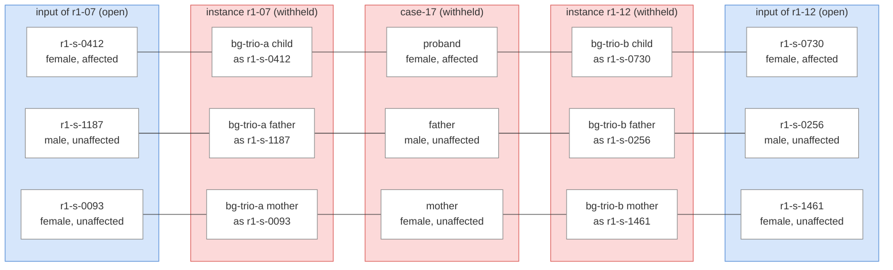
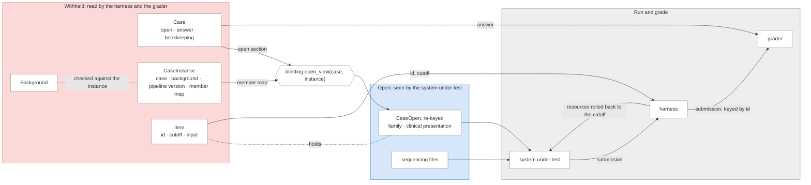

# The schema

The schema describes three things: the record a curator writes for one solved case, how a case is built into the
sequencing data of a background family as one case instance of a release, and what a system under test receives for that
instance. The types live in [`schema/`](../schema/src/rare_disease_benchmark/schema), and this document explains how
they fit together.

Everything in a release is on one of two sides. The open side is what a system under test sees: the sequencing files,
and the pedigree and clinical presentation keyed by release sample ids. The withheld side is everything else, and only
the harness and the grader read it. It holds the answer the grader compares a submission against, the instance id and
cutoff the harness needs to run each case instance, and everything about how an instance was built, such as the
background family it went into. The system under test needs none of these, and some would give part of the answer away.
Most of the design follows from keeping that split hard to get wrong.

## Overview

Red classes are withheld, read only by the harness and the grader; blue classes are open, seen by the system under test.
Every model in the code derives from `WithheldModel` or `OpenModel` accordingly. Solid arrows are containment, dashed
arrows a reference by id.

```mermaid
classDiagram
    direction LR

    namespace Withheld {
        class WithheldRelease {
            release: str
            cases: Case[*]
            backgrounds: Background[*]
            instances: CaseInstance[*]
        }
        class Case {
            id: CaseId
            source: Source
            provenance: real | derived | invented
            sharing: internal | partners | public
            notes: str?
            open: CaseOpen
            answer: CaseAnswer
        }
        class Source {
            programme: str?
            accession: str?
        }
        class CaseAnswer {
            placements: Placement[*]
            diagnoses: Diagnosis[1..*]
            cutoff() date?
            set_aside() Variant[*]
        }
        class Placement {
            haplotype: Haplotype
            variant: Variant
            vaf: float?
        }
        class Haplotype {
            individual: SampleId
            name: HaplotypeName
        }
        class HaplotypeName {
            <<enumeration>>
            paternal
            maternal
            transmitted
            non_transmitted
        }
        class Variant {
            chrom: str
            pos: int
            ref: str
            alt: str
            end: int?
            origin: Haplotype?
        }
        class Diagnosis {
            disease: str
            ontology_id: str?
            inheritance: Inheritance
            variants: CausativeVariant[1..*]
            association_first_public_date: date?
        }
        class CausativeVariant {
            variant: Variant
            first_public_date: date?
        }
        class Inheritance {
            <<enumeration>>
            AD
            AR
            XLD
            XLR
            MT
        }
        class Background {
            id: BackgroundId
            child_sex: male | female
        }
        class CaseInstance {
            id: CaseInstanceId
            case: CaseId
            background: BackgroundId
            pipeline_version: str
            members: InstanceMember[*]
        }
        class Item {
            id: CaseInstanceId
            cutoff: date?
            input: CaseOpen
        }
        class InstanceMember {
            sample: SampleId
            release_sample: ReleaseSampleId
        }
    }

    namespace Open {
        class CaseOpen {
            family: Family
            clinical_presentation: ClinicalPresentation[*]
        }
        class Family {
            proband: SampleId
            members: Individual[*]
        }
        class Individual {
            id: SampleId
            father: SampleId?
            mother: SampleId?
            sex: male | female | unknown
            affected: bool?
        }
        class ClinicalPresentation {
            individual: SampleId
            hpo_present: str[*]
            hpo_excluded: str[*]
            onset, age, panel: str?
            reason_for_referral: str?
            text: str?
        }
    }

    WithheldRelease *-- Case : cases
    WithheldRelease *-- Background : backgrounds
    WithheldRelease *-- CaseInstance : instances
    Case *-- Source : source
    Case *-- CaseOpen : open
    Case *-- CaseAnswer : answer
    CaseAnswer *-- Placement : placements
    CaseAnswer *-- Diagnosis : diagnoses
    Placement *-- Haplotype : haplotype
    Placement *-- Variant : variant
    Haplotype --> HaplotypeName : name
    Variant *-- Haplotype : origin
    Diagnosis *-- CausativeVariant : variants
    Diagnosis --> Inheritance : inheritance
    CausativeVariant *-- Variant : variant
    CaseInstance ..> Case : case
    CaseInstance ..> Background : background
    CaseInstance *-- InstanceMember : members
    CaseOpen *-- Family : family
    CaseOpen *-- ClinicalPresentation : clinical_presentation
    Family *-- Individual : members
    Item *-- CaseOpen : input, re-keyed

    style WithheldRelease fill:#fcd9d9,stroke:#d9534f
    style Case fill:#fcd9d9,stroke:#d9534f
    style Source fill:#fcd9d9,stroke:#d9534f
    style CaseAnswer fill:#fcd9d9,stroke:#d9534f
    style Placement fill:#fcd9d9,stroke:#d9534f
    style Haplotype fill:#fcd9d9,stroke:#d9534f
    style HaplotypeName fill:#fcd9d9,stroke:#d9534f
    style Variant fill:#fcd9d9,stroke:#d9534f
    style Diagnosis fill:#fcd9d9,stroke:#d9534f
    style CausativeVariant fill:#fcd9d9,stroke:#d9534f
    style Inheritance fill:#fcd9d9,stroke:#d9534f
    style Background fill:#fcd9d9,stroke:#d9534f
    style CaseInstance fill:#fcd9d9,stroke:#d9534f
    style InstanceMember fill:#fcd9d9,stroke:#d9534f
    style Item fill:#fcd9d9,stroke:#d9534f
    style CaseOpen fill:#d6e6fb,stroke:#4a86d4
    style Family fill:#d6e6fb,stroke:#4a86d4
    style Individual fill:#d6e6fb,stroke:#4a86d4
    style ClinicalPresentation fill:#d6e6fb,stroke:#4a86d4
```

## The case record

A case holds everything a laboratory knew and concluded about one family, and nothing about any background genome. Its
placements name chromosome copies by their relation to the proband (the proband's paternal copy, the copy the father
transmitted to her), and that is what lets one case be built into any background trio whose child has the proband's sex.

The record has two sections because its fields go to two different readers. `open` holds the family and the clinical
presentation, which a system under test receives. `answer` holds the placements and the diagnoses, which only the grader
reads; placed variants that belong to no diagnosis are the candidates the laboratory set aside. The bookkeeping fields
(source, provenance, sharing level and notes) are withheld as well. Adding a field to the record therefore means
choosing a section, and the reviewer sees that choice in the diff. In a flat record the same decision would be hidden in
whichever function copies fields to the open side, and a field nobody remembered to copy would go missing from the input
without any error.

`open` reaches the system under test in the same shape, keyed by release sample ids rather than the record's own member
ids, and nothing derived from `answer` reaches it. The harness does read one such value, the cutoff: the earliest date
any causative variant became public, before which it rolls back clinical-assertion databases and literature so that the
answer cannot be looked up.

## Case instances

A case instance is one case built into one background, as issued in one release. It is the unit a system under test
analyses, and the harness runs it under its id. It holds no case data of its own: it names the case and the background,
and gives each member of the case's family the id it carries in this release. A release may contain several instances of
one case in different backgrounds, which is how a result is checked for robustness to the background.

The example below is the invented case 17 from the test fixture: an affected girl and her unaffected parents, built into
two background trios in release 1.0.0. The proband goes into each background's child, so both backgrounds need a
daughter, and the parents into its parents. Both case instances are withheld, like the case; the inputs at either edge
are what the system under test sees. Each instance gives every member a fresh release sample id, so nothing it sees
connects the two inputs, points back to the case, or names a background.

Each input carries the pedigree: the case's family with the ids replaced, so sex and affected status are recorded once,
in the case. The instance column is for the reader; the system under test sees only the other five.

| Instance | Sample    | Father    | Mother    | Sex    | Affected |
| -------- | --------- | --------- | --------- | ------ | -------- |
| r1-07    | r1-s-0412 | r1-s-1187 | r1-s-0093 | female | yes      |
| r1-07    | r1-s-1187 |           |           | male   | no       |
| r1-07    | r1-s-0093 |           |           | female | no       |
| r1-12    | r1-s-0730 | r1-s-0256 | r1-s-1461 | female | yes      |
| r1-12    | r1-s-0256 |           |           | male   | no       |
| r1-12    | r1-s-1461 |           |           | female | no       |

A case recorded without parents builds into the same trio backgrounds and yields the proband's files only. The checks on
a release reject an instance whose family goes beyond the proband and their parents, whose proband's sex differs from
the background child's, or whose release sample ids contain the case id or the source accession.

Two instances of one case carry the same clinical presentation and the same placed variants in different backgrounds. A
harness that pooled a whole release could pair them and intersect their novel variants, which leaves little besides the
placements, so each item has to be analysed in a session of its own. And because a case with more instances would
otherwise weigh more, a result over such a release is best averaged per case first, with the spread across a case's
instances reported beside it.

## From withheld to open

`blinding.open_view` is the only code that copies case data to the open side. It takes a case and one of its instances
and returns the case's open section, re-keyed through the instance's member map; with the sequencing files, that is all
the system under test sees. The harness reads the withheld side: for each case instance, `item.items` gives it the
instance id it keys the submission and the trace by, the cutoff it rolls resources back to, and the open input it passes
on. The grader reads the answer directly from the withheld side.

The cutoff stays hidden from the system under test because it is the date a causative variant became public, and a model
that knew it could try to recall which variants appeared around then. For the same reason, the harness should not pass
on the version dates of the resources it rolls back.

This assumes that every party running a harness also holds the release's withheld side, as each collaborator does today.
A party that ran a release without it, and sent its submissions elsewhere to be graded, would need the instance ids and
cutoffs published separately. That would add a third tier between the two sides and change what a release ships.

Three tests keep the boundary in place. Two walk every type reachable from `CaseOpen`, the only open data: one fails if
any of them is a `WithheldModel`, the other if a field is typed with a withheld id (`CaseId`, `BackgroundId` or
`CaseInstanceId`). A withheld type or id placed on the open side therefore fails CI. The third serialises the open
inputs of the fixture and fails if the case id, a record member id, a background id, an instance id, the cutoff or a
placed position appears among their values.
